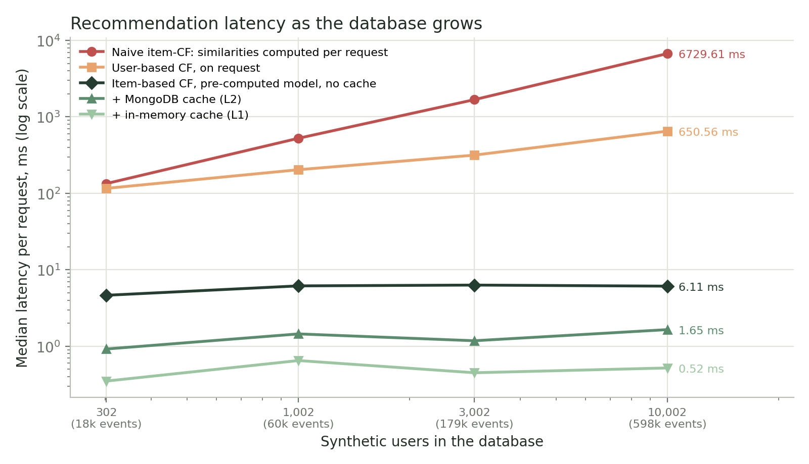
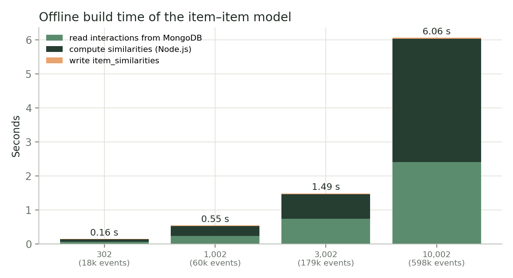
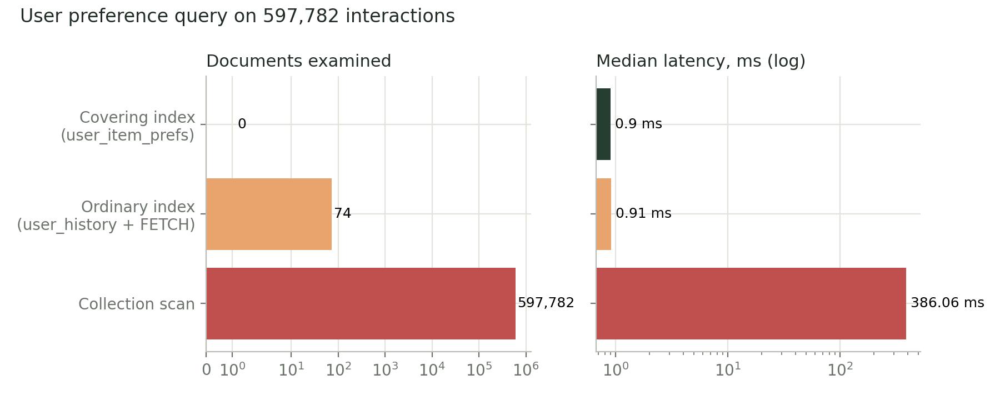
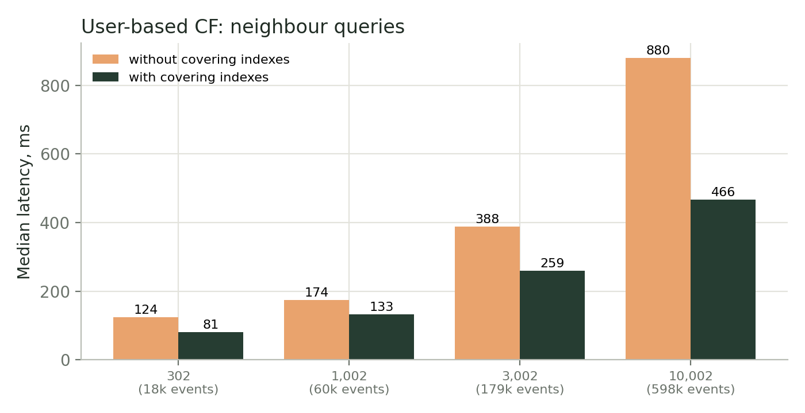

# Performance testing and optimisation

How the recommendation engine behaves as the database grows, and which optimisations make it fast.
Raw results: [`perf/benchmark.json`](perf/benchmark.json) · charts: `perf/*.png` (re-draw with `python scripts/charts.py`).

## 1. Method

`npm run benchmark -- --sizes=300,1000,3000,10000 --samples=100` re-seeds the separate database `tourism_recsys_bench`
four times with the deterministic synthetic generator (64 destinations, 300 → 10 000 travellers, 18 k → 598 k
interactions) and measures, for 100 randomly chosen users (the same users for every variant):

| Variant | What a request does |
|---|---|
| Naive item-CF | reads the **whole** interaction log and computes all item–item similarities on every request (5 samples) |
| Item-CF, pre-computed | reads the user's preferences + the stored neighbour lists (`item_similarities`), cache off |
| + L2 cache | reads the finished list from the `recommendation_cache` collection |
| + L1 cache | reads the finished list from the in-process LRU cache |
| User-CF, on request | finds similar travellers on every request (candidate pruning to 300) |

Latencies are measured inside the Node.js process around the service call (database round trips included, HTTP
excluded). Test machine: Intel Core i7-10510U (4 cores / 8 threads, 1.8 GHz), 16 GB RAM, Windows 11, Node.js 24,
MongoDB 8.0.4 (standalone, local). Absolute numbers depend on the machine; the ratios are what matters.

## 2. Results

### Request latency (median / 95th percentile, ms)

| Users | Interactions | Naive item-CF | **Item-CF** | Item-CF + L2 | Item-CF + L1 | User-CF |
|---:|---:|---:|---:|---:|---:|---:|
| 302 | 17 921 | 134 | **4.6** / 6.5 | 0.92 | 0.35 | 116 / 137 |
| 1 002 | 60 283 | 525 | **6.2** / 7.8 | 1.45 | 0.65 | 204 / 272 |
| 3 002 | 179 430 | 1 681 | **6.3** / 9.3 | 1.18 | 0.45 | 316 / 504 |
| 10 002 | 597 782 | 6 730 | **6.1** / 7.8 | 1.65 | 0.52 | 651 / 1 156 |

* The naive variant grows linearly with the event log (134 ms → 6.7 s): unusable beyond a few thousand users.
* With the **pre-computed model** the latency stays flat at ≈ 6 ms from 18 k to 598 k interactions — a
  **≈ 1 100× speed-up** at 10 000 users. A request touches only the user's own events and ≤ 30 neighbour lists per
  liked place, which does not depend on the total number of users.
* The **cache** removes even that: 1–2 ms from MongoDB (L2), ≈ 0.5 ms from memory (L1).
* **User-based CF** grows with the data (116 → 651 ms) because the number of travellers who share places with the user
  grows. Candidate pruning bounds the second query, but the first one still aggregates the events of all places the
  user liked. This is why item-based CF is the default and user-based CF is an option.

### Model build (offline)

| Users | Interactions | Read | Compute | Total (incl. write) |
|---:|---:|---:|---:|---:|
| 302 | 17 921 | 65 ms | 80 ms | 0.16 s |
| 1 002 | 60 283 | 243 ms | 291 ms | 0.55 s |
| 3 002 | 179 430 | 741 ms | 725 ms | 1.49 s |
| 10 002 | 597 782 | 2 408 ms | 3 622 ms | 6.06 s |

The build is linear in the number of events and runs once per `CF_MODEL_TTL_MINUTES` (default 60 min), not per
request. Its output is tiny: 64 documents, 109 KB, independent of the number of users.

### Index effect — the user preference query (10 002 users, 597 782 interactions)

| Access path | Plan | Keys | Documents examined | Median |
|---|---|---:|---:|---:|
| Collection scan | `COLLSCAN` | 0 | 597 782 | 386 ms |
| Ordinary index `user_history` | `FETCH > IXSCAN` | 74 | 74 | 0.91 ms |
| **Covering index `user_item_prefs`** | `PROJECTION_COVERED > IXSCAN` | 74 | **0** | 0.90 ms |

An index on `userId` is essential (≈ 400× faster than the scan). The covering index additionally answers the query
without reading any document; for one user (74 events, all in RAM) this hardly changes the time, but it matters when
many events are read — the user-based CF queries:

| Users | Neighbour queries **without** covering indexes | **with** covering indexes | Speed-up |
|---:|---:|---:|---:|
| 302 | 125 ms | 81 ms | 1.5× |
| 1 002 | 174 ms | 133 ms | 1.3× |
| 3 002 | 388 ms | 259 ms | 1.5× |
| 10 002 | 880 ms | 466 ms | 1.9× |

### Storage cost (10 002 users)

| Collection | Documents | Data | Indexes |
|---|---:|---:|---:|
| `interactions` | 597 782 | 93.0 MB | 48.8 MB (of which the two new covering indexes 7.5 + 7.4 MB) |
| `item_similarities` | 64 | 109 KB | 20 KB |
| `recommendation_cache` | 100 | 809 KB | 60 KB |

The covering indexes cost ≈ 15 MB (≈ 16 % of the data size) and one more index update per inserted interaction —
acceptable for a read-heavy recommender.

## 3. Optimisations implemented

1. **Pre-computed item–item model** (`item_similarities`, top-30 neighbours per place) instead of computing similarities
   per request — constant request cost independent of the number of users.
2. **Covering compound indexes** `{userId, itemId, type, weight}` and `{itemId, userId, type, weight}` — the CF queries
   are answered from the index only (`PROJECTION_COVERED`, 0 documents examined).
3. **Projection** of only the four needed fields in every CF query and in the model build (small documents over the wire).
4. **Two-level cache**: in-process LRU (L1) + MongoDB collection with a **TTL index** (L2, shared by serverless
   instances); invalidated per user on every interaction, and ignored after a model rebuild (`modelVersion`).
5. **Candidate pruning** in user-based CF: only the 300 travellers with the largest overlap are compared.
6. **Top-k truncation and shrinkage** in the model: fewer, more reliable neighbours → smaller documents, better accuracy.
7. **Background model refresh**: a stale model is rebuilt without blocking requests.

## 4. Conclusions

* With the optimisations a personalised list is served in ≈ 6 ms without cache and ≈ 0.5–1.7 ms with cache, and this
  does not grow from 300 to 10 000 users (18 k → 598 k events).
* The cost of personalisation was moved from the request to an offline job that takes 6 s at 10 000 users and runs once
  an hour. For much larger logs the build could be done incrementally or with an aggregation pipeline / `$merge` on a
  replica set, and the event log could be sharded by `userId`.
* Limitations: synthetic data, one local machine, a single client (no concurrent load test), 64 destinations (a larger
  catalogue would make the neighbour lists and the build more expensive).
